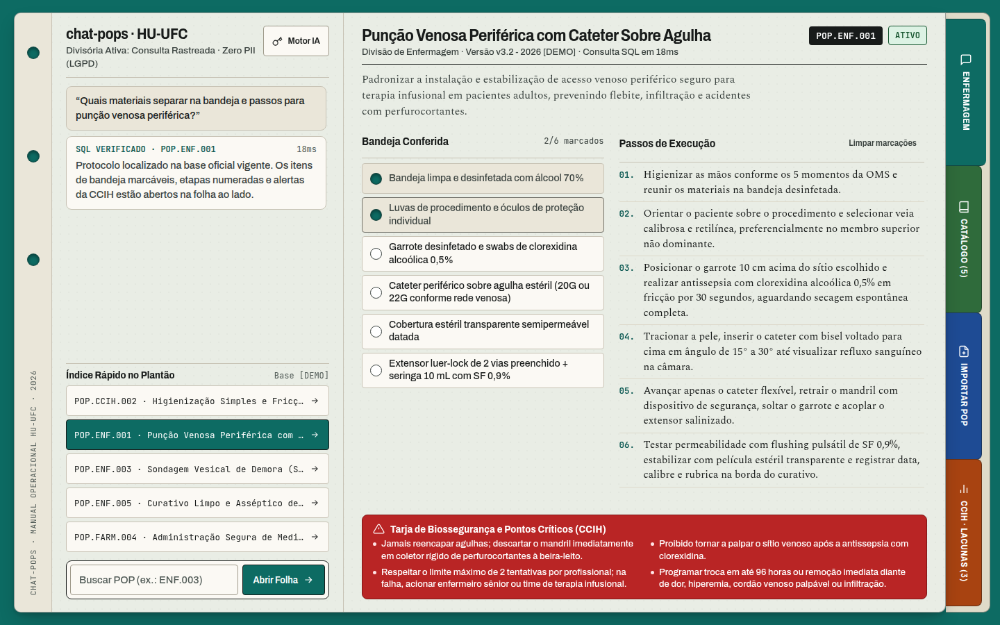
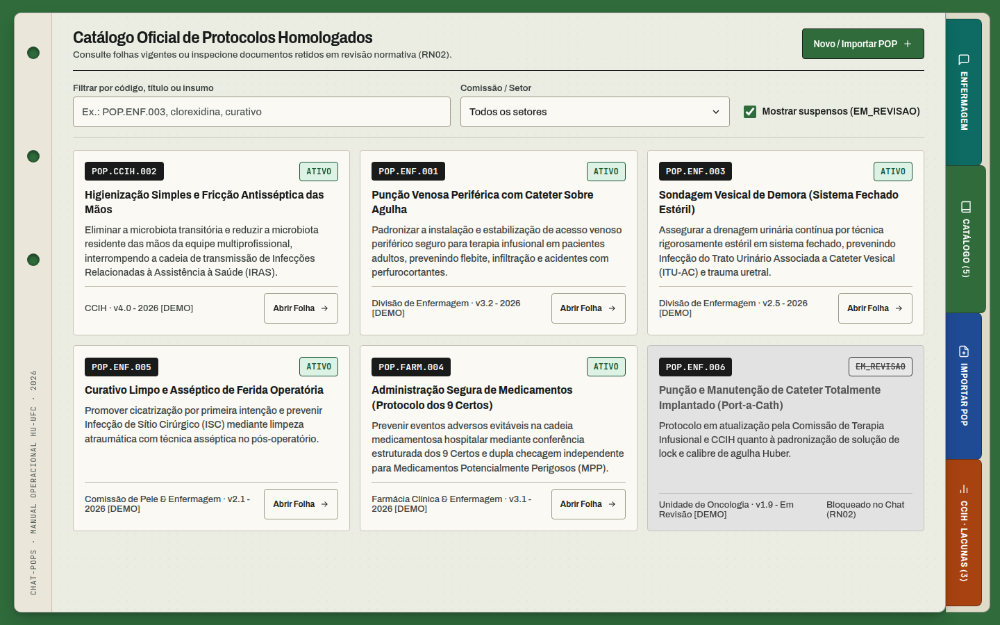
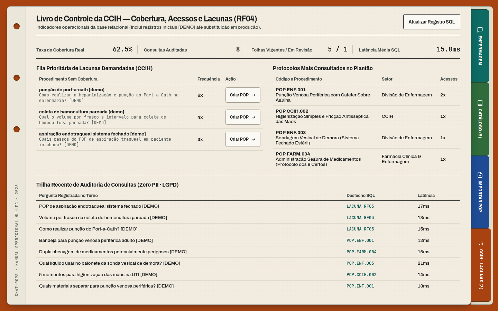
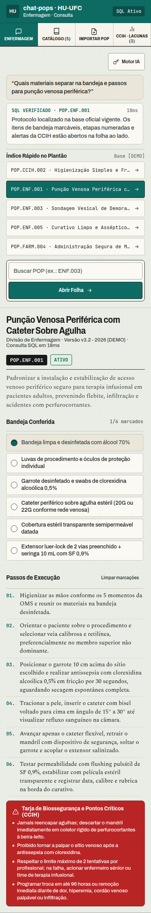
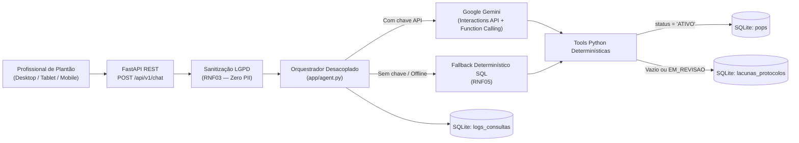

# `chat-pops` — Copiloto de Procedimentos Operacionais Padrão (POPs) Hospitalares

> **Assistente conversacional interno (B2E) com *Human-in-the-Loop*** voltado a profissionais de enfermagem, internos, residentes e gestores da CCIH de Hospitais Universitários (contexto **HU-UFC / PET Saúde Digital**) para consulta rápida, estruturada e 100% rastreável de **Procedimentos Operacionais Padrão (POPs)** homologados — com prevenção determinística de alucinações e mapeamento automático de lacunas de protocolo.

---

## 1. Qual é a dor real?

Em Hospitais Universitários com alta rotatividade de estudantes, internos e residentes, cada procedimento assistencial precisa seguir rigorosamente os **POPs institucionais vigentes** (`POP.ENF.001`, `POP.CCIH.002`, etc.). Na prática do plantão, porém, esses protocolos ficam espalhados em dezenas de PDFs extensos (15 a 40 páginas) na intranet, dificultando a conferência rápida de **materiais de bandeja**, **etapas de execução** e **pontos críticos de biossegurança** antes de ir ao leito.

### Por que B2E com Fonte Única de Verdade (e não IA livre ao paciente)?
Na concepção do produto, **descartou-se o uso de IA generativa voltada diretamente ao paciente final**, pois o risco clínico de alucinação supera o benefício. Em vez disso, o `chat-pops` aplica uma arquitetura **anti-alucinação orientada a banco relacional**:

1. **Fonte Única de Verdade (RN01):** Toda lista de materiais, passo a passo e alerta vem exclusivamente da tabela SQL `pops`, com citação obrigatória de `codigo` e `versao`.
2. **Bloqueio de Protocolos Suspensos (RN02):** Apenas registros com `status = 'ATIVO'` podem orientar procedimentos no chat; documentos `EM_REVISAO` aparecem retidos no catálogo e são bloqueados automaticamente.
3. **Recusa Segura + Inteligência de Gestão (RF03 / RN03):** Se um procedimento não existe (ou está em revisão), o assistente **recusa inventar condutas** e registra/incrementa automaticamente a demanda em `lacunas_protocolos` para priorização pela **CCIH** e pela **Divisão de Enfermagem**.
4. **Privacidade by Design — LGPD (RNF03):** O sistema não coleta nem exige dados de pacientes (PII/PHI) e aplica sanitização preventiva caso identificadores como CPF sejam digitados acidentalmente.

---

## 2. Interface — *O Fichário Cirúrgico de Acetato Leitoso*

A identidade visual foi projetada no navegador e documentada em [DESIGN.md](./DESIGN.md) a partir da metáfora do **fichário físico de POPs do posto de enfermagem**: uma folha clara antirreflexo perfurada sobre divisórias rígidas coloridas por comissão/função, com contraste WCAG AA (`>= 4.5:1`), alvos de toque mínimos de `44px` e checklist interativo de bandeja.

### Consulta de Plantão & Checklist Perfurado de Bandeja (Desktop `1440×900`)


### Catálogo Oficial (com bloqueio visual `EM_REVISAO`) & Livro de Controle da CCIH
| Catálogo Homologado (`RF05` / `RN02`) | Painel da CCIH — Cobertura, Acessos e Lacunas (`RF04`) |
| :---: | :---: |
|  |  |

<details>
<summary><strong>Ver adaptação Mobile à beira-leito (390×844 — RNF06)</strong></summary>

<p align="center">
  
</p>

</details>

---

## 3. Arquitetura e Decisões de Engenharia



### Destaques Técnicos
- **Backend & API:** Python 3 + **FastAPI** com validação **Pydantic v2** e documentação OpenAPI/Swagger automática.
- **Orquestração IA Desacoplada:** Integração com o SDK oficial **`google-genai` (Interactions API)** usando *Function Calling* (`buscar_pops_sql` e `registrar_lacuna_sql`), com conexão BYOK opcional no botão **Motor IA** (armazenada apenas em `sessionStorage`) e **modo fallback determinístico offline** completo para testes e uso sem chave externa.
- **Persistência SQL (SQLite compatível com PostgreSQL):** Modelagem normalizada em 3 tabelas (`pops`, `lacunas_protocolos`, `logs_consultas`) inicializadas automaticamente com **5 POPs ativos padrão EBSERH/HU + 1 POP `EM_REVISAO`** explicitamente rotulados com `[DEMO]` até a importação dos documentos oficiais dos supervisores.
- **Importação de Documentos:** Endpoint `POST /api/v1/pops/extrair-arquivo` e tela dedicada para carregar arquivos `.md`, `.txt` ou `.json` e homologar novos POPs diretamente na base.

---

## 4. Contratos da API REST

| Método | Endpoint | Propósito |
| :--- | :--- | :--- |
| `POST` | `/api/v1/chat` | Recebe `pergunta` (e opcionalmente `setor_usuario` e header `X-Gemini-Api-Key`), aplica sanitização LGPD, consulta POPs ativos, grava auditoria/lacuna e retorna resposta estruturada + metadados do POP citado. |
| `GET` | `/api/v1/pops` | Lista POPs com filtros opcionais por `termo`, `setor` e `incluir_inativos`. |
| `GET` | `/api/v1/pops/{codigo}` | Consulta direta de um protocolo pelo código oficial (ex.: `POP.ENF.001`). |
| `POST` | `/api/v1/pops` | Cadastra e homologa um novo POP na base relacional (`409 Conflict` em duplicidade). |
| `POST` | `/api/v1/pops/extrair-arquivo` | Extrai rascunho estruturado de arquivos `.json`, `.md` ou `.txt` para revisão antes da gravação. |
| `GET` | `/api/v1/analytics/resumo` | Indicadores gerenciais da CCIH: taxa de cobertura (%), total de consultas, latência média SQL, ranking de POPs mais consultados, fila de lacunas e últimos logs. |
| `GET` | `/api/v1/health` | Verificação de saúde do serviço. |

---

## 5. Como Executar Localmente

```bash
# 1. Clonar o repositório
git clone https://github.com/cicerocarnauba/chat-pops.git
cd chat-pops

# 2. Criar ambiente virtual e instalar dependências
python3 -m venv .venv
source .venv/bin/activate
pip install -r requirements.txt

# 3. (Opcional) Configurar chave da Google Gemini API
# Sem chave configurada, o sistema opera normalmente em modo SQL determinístico offline.
cp .env.example .env

# 4. Iniciar a API + Interface Web
uvicorn app.main:app --reload
```

Acesse no navegador:
- **Interface Web (`chat-pops`):** http://127.0.0.1:8000/
- **Swagger / OpenAPI:** http://127.0.0.1:8000/docs

### Exemplo Rápido via `curl`
```bash
# Consulta positiva (POP ativo)
curl -s -X POST http://127.0.0.1:8000/api/v1/chat \
  -H "Content-Type: application/json" \
  -d '{"pergunta": "Quais materiais preciso para punção venosa periférica?"}' | python3 -m json.tool

# Consulta sem cobertura (Recusa Segura + registro de lacuna na CCIH)
curl -s -X POST http://127.0.0.1:8000/api/v1/chat \
  -H "Content-Type: application/json" \
  -d '{"pergunta": "Qual o POP para passagem de balão intra-aórtico?"}' | python3 -m json.tool
```

### Executar Testes Automatizados (`pytest`)
```bash
pytest -v
```
A suíte (`8/8` testes em [tests/test_chat_pops.py](./tests/test_chat_pops.py)) valida de forma determinística e offline:
- Carga do catálogo inicial (`5` POPs `ATIVO` + `1` `EM_REVISAO`);
- Resposta positiva com citação obrigatória de código e versão (`RF01`, `RF02`, `RNF01`);
- Bloqueio de POP `EM_REVISAO` com recusa segura (`RN02`);
- Incremento de contador de lacunas e reflexo nos indicadores analíticos (`RF03`, `RF04`);
- Cadastro de novo POP e disponibilização imediata no chat (`RF05`);
- Sanitização preventiva de CPF/PII antes do log (`RNF03` — LGPD);
- Orquestração *Function Calling* da Interactions API isolada via *stub* (`RNF05`).

---

## 6. Estrutura do Repositório

```text
chat-pops/
├── app/
│   ├── agent.py              # Orquestrador Gemini (Interactions API) + fallback SQL + guarda LGPD
│   ├── database.py           # Schema SQLite e seed demonstrativo [DEMO] padrão EBSERH/HU
│   ├── main.py               # Endpoints FastAPI e serviço da interface web
│   ├── repository.py         # Consultas SQL normalizadas, lacunas, auditoria e analytics
│   ├── schemas.py            # Contratos Pydantic v2
│   └── static/               # Frontend responsivo (HTML5, CSS3 e JS puro)
├── docs/
│   ├── 01_ELICITACAO_REQUISITOS.md
│   ├── 02_ARQUITETURA_E_DADOS.md
│   ├── 03_DESIGN_E_INTERFACE.md
│   └── assets/               # Capturas validadas da interface (Desktop e Mobile)
├── tests/
│   └── test_chat_pops.py     # Suíte automatizada pytest
├── DESIGN.md                 # Design System normativo (tokens YAML + regras visuais)
├── PRODUCT.md                # Verdade de produto e restrições operacionais
├── pyproject.toml
└── requirements.txt
```

---

## 7. Documentação Completa do Processo de Engenharia

1. [x] **Fase 1:** [Elicitação de Requisitos (RFs, RNs e RNFs ISO/IEC 25010)](./docs/01_ELICITACAO_REQUISITOS.md)
2. [x] **Fase 2:** [Arquitetura, Modelagem de Dados (SQL) & Contratos da API](./docs/02_ARQUITETURA_E_DADOS.md)
3. [x] **Fase 3:** [Design, Fluxo Operacional](./docs/03_DESIGN_E_INTERFACE.md) & [Design System (`DESIGN.md`)](./DESIGN.md)
4. [x] **Fase 4:** Implementação Guiada em Python (FastAPI + SQLite + Gemini Function Calling) & Testes Automatizados (`pytest`)
5. [x] **Fase 5:** Documentação Final de Portfólio (`README.md`)

> **Aviso de Uso Demonstrativo:** Os 5 protocolos iniciais e indicadores de exemplo embarcam dados sintéticos rotulados com `[DEMO]` para fins de demonstração técnica e engenharia de software, não substituindo os documentos oficiais vigentes publicados pela comissão responsável do hospital.
