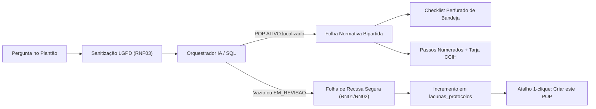

# Fase 3: Design, Identidade Visual & Fluxo Operacional — `chat-pops`

**Projeto:** `chat-pops` (Copiloto de Procedimentos Operacionais Padrão Hospitalares)  
**Contexto:** Hospital Universitário (HU-UFC) / Ecossistema PET Saúde Digital  
**Direção Escolhida no Navegador:** *Fichário de Posto com Abas Setoriais* (`rw-manual-acetate-tab-board`)  
**Especificação Normativa de Tokens:** [`DESIGN.md`](../DESIGN.md) e [`.impeccable/design.json`](../.impeccable/design.json)

---

## 1. Síntese da Decisão Visual

A identidade visual foi selecionada interativamente no navegador por meio do fluxo estruturado **Impeccable**, confrontando direções hospitalares fundamentadas e sistemas gráficos de referência. A escolha recaiu sobre a metáfora funcional do **Fichário Técnico de Posto de Enfermagem com Folha de Acetato e Abas Escalonadas**:

1. **Reconhecimento Imediato no Plantão:** Enfermeiros, residentes e membros da CCIH operam diariamente pastas e fichários físicos de POPs no posto de enfermagem. A interface traduz essa gramática física — furos de encadernação à esquerda, folha clara antirreflexo (`#F6F4EC`) no centro e abas laterais escalonadas por função/comissão à direita — eliminando a aparência genérica de um chatbot corporativo.
2. **Codificação Cromática Estrutural por Divisória:**
   - **Enfermagem · Consulta (`#0F766E`):** Consulta em linguagem natural pareada à folha normativa bipartida.
   - **Catálogo Vigente (`#3B7A47`):** Biblioteca filtrável por código, insumo ou comissão, com desativação automática em escala de cinza para protocolos `EM_REVISAO` (RN02).
   - **Importar / Novo POP (`#1F4E99`):** Cadastro estruturado e importação de arquivos `.md`, `.txt` e `.json` enviados pelos supervisores.
   - **CCIH · Lacunas e Auditoria (`#C95B1E`):** Indicadores de cobertura, latência SQL, ranking de demandas reprimidas e histórico auditável.
3. **Zero Fadiga Visual e Contraste Clínico:** Tipografia de interface em `Archivo`, passos operacionais em `Spectral` (medida controlada até `68ch` para leitura sem esforço sob luz intensa de posto) e códigos/métricas em `JetBrains Mono` com numerais tabulares.

---

## 2. Fluxo Conversacional e Estados Críticos de Segurança

### Estados Projetados na Interface
- **Sucesso Rastreado (RF01/RF02):** Exibe carimbo de código (`POP.ENF.001`), versão (`v3.2 - 2026 [DEMO]`), latência SQL em milissegundos, lista interativa de materiais (onde cada clique "perfura" o círculo revelando a cor da divisória abaixo) e tarja vermelha vermelhão (`#C42B2B`) exclusiva para pontos críticos da CCIH.
- **Recusa Segura e Comprovante de Lacuna (RF03/RN02):** Quando não há protocolo `ATIVO` (ou quando o protocolo está retido como `EM_REVISAO`), a folha direita bloqueia qualquer instrução clínica improvisada, exibe o aviso institucional e entrega o comprovante da demanda registrada para a CCIH com botão direto para cadastrar o protocolo faltante.
- **Proteção LGPD (RNF03):** Caso o profissional digite acidentalmente um CPF ou identificador nominal na consulta, o sistema remove o dado antes de gravar em `logs_consultas` e exibe aviso educativo discreto no turno.

---

## 3. Adaptação Responsiva Multi-Dispositivo (RNF06)

- **Desktop (`> 1120px` — Computador do Posto):** Trilho esquerdo de encadernação (`56px`), folha dupla lado a lado (conversa + protocolo completo visível sem rolagem longa) e abas verticais escalonadas na margem direita.
- **Tablet (`768px–1120px` — Ronda em Enfermaria):** Empilhamento fluido entre consulta e folha de protocolo mantendo as abas laterais rápidas.
- **Smartphone (`< 768px` até `320px` — Beira-Leito):** Cabeçalho superior colorido da divisória ativa, folha em coluna única sem cortes horizontais e barra inferior fixa de 4 abas com alvos de toque amplos (`>= 44px`).
